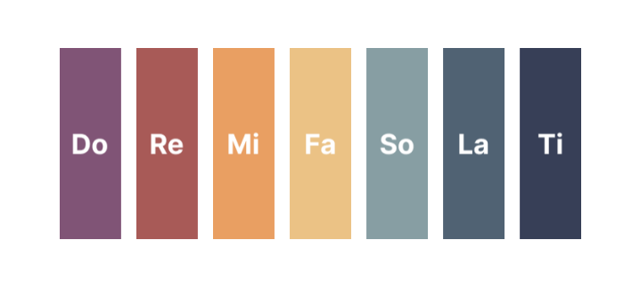
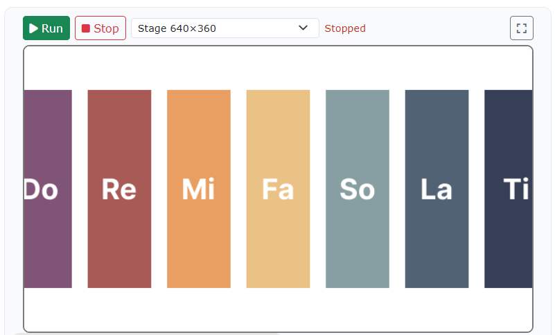
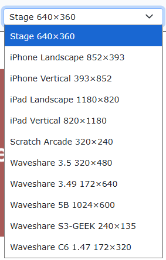
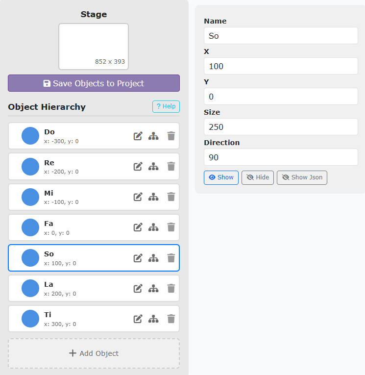
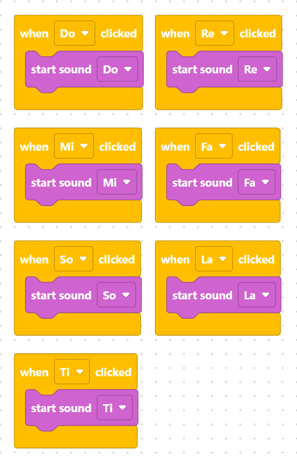

## Project Overview
In this project, you will step up to Level 2 and build an interactive **Piano App**. You will customize the stage size to fit mobile dimensions (iPhone Landscape), add 7 distinct piano keys representing the notes "do, re, mi, fa, so, la, ti", upload corresponding audio assets, and code click event handlers to play each musical note.


## Learning Objectives
* **Stage Layout Settings:** Resize the stage dimensions to fit a custom resolution (`iPhone Landscape 852 x 393`).
* **Multi-Object Management:** Create, position, and resize multiple interactive sprite keys.
* **Audio Integration:** Upload and trigger audio assets via click events (`start_sound`).


## What You Are Building

> {width=inherit}

You will create a working piano keyboard interface featuring 7 interactive keys:

* **Stage Setup:** Configured to an iPhone Landscape layout.
* **Key Sprites (`Do`, `Re`, `Mi`, `Fa`, `So`, `La`, `Ti`):** Positioned neatly across the screen.
* **Interactive Audio:** Clicking any key instantly plays its respective musical note.


## Step 1 - Change Stage Size
Go to the stage settings and change the size of the stage from the default `"Stage 640 x 360"` to `"iPhone Landscape 852 x 393"`.

> {width=inherit}
> {width=inherit}


## Step 2 - Add 7 Piano Key Objects
Open the Object Library and add 7 separate objects to represent the piano notes. Name them cleanly:
1. **`Do`**
2. **`Re`**
3. **`Mi`**
4. **`Fa`**
5. **`So`**
6. **`La`**
7. **`Ti`**


## Step 3 - Resize and Position the Keys
Select each key object and arrange them horizontally across your iPhone Landscape stage. Adjust their size values in the properties panel so they look like a clean piano keyboard layout.

> {width=inherit}


## Step 4 - Upload Sound Assets
Go to the Sound tab for each respective key object and upload the corresponding audio asset file for notes **Do**, **Re**, **Mi**, **Fa**, **So**, **La**, and **Ti**.


## Step 5 - Code the Piano Keys
Program each individual key so that when it is clicked, it plays its matching sound asset:

> {width=inherit}

### MicroPython Code

```python
# Play Do note
def when_Do_clicked():
    start_sound("Do")

# Play Re note
def when_Re_clicked():
    start_sound("Re")

# Play Mi note
def when_Mi_clicked():
    start_sound("Mi")

# Play Fa note
def when_Fa_clicked():
    start_sound("Fa")

# Play So note
def when_So_clicked():
    start_sound("So")

# Play La note
def when_La_clicked():
    start_sound("La")

# Play Ti note
def when_Ti_clicked():
    start_sound("Ti")