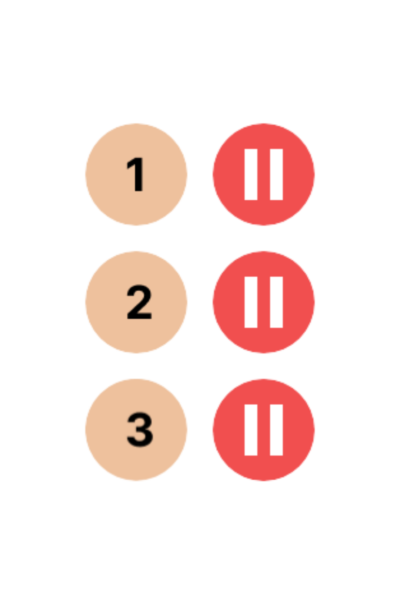
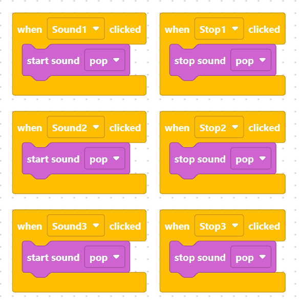

## Project Overview
In this project, you will continue exploring Level 2 features by creating an **Insect Jukebox App**. You will set up mobile-friendly stage dimensions, add audio control objects (numbered play buttons and pause/stop buttons), upload custom sound assets, and program click event handlers to start and stop audio playback dynamically.


## Learning Objectives
* **Stage Layout Settings:** Configure stage dimensions to fit mobile portrait or custom layouts.
* **Multi-Object Management:** Create, position, and organize multiple interactive buttons for media controls.
* **Audio Control Handling:** Program both `start_sound` and `stop_sound` actions triggered by independent button clicks.


## What You Are Building

> {width="400"}

You will create a working jukebox interface featuring multiple sound tracks and independent stop controls:

* **Play Buttons (`Sound1`, `Sound2`, `Sound3`):** Triggers audio playback when clicked.
* **Stop Buttons (`Stop1`, `Stop2`, `Stop3`):** Halts audio playback immediately when clicked.
* **Interactive Audio:** Gives users complete playback control over sound assets.


## Step 1 - Configure the Stage Size
Go to the stage settings and adjust your stage dimensions to fit your mobile application layout.


## Step 2 - Add Jukebox Objects
Open the Object Library and add objects to represent your tracks and pause controls. Name them cleanly:
1. **`Sound1`** and **`Stop1`**
2. **`Sound2`** and **`Stop2`**
3. **`Sound3`** and **`Stop3`**

*(You can draw them yourself using the paint editor or upload custom button assets).*

> {width=inherit}
> {width=inherit}
> {width=inherit}
> {width=inherit}


## Step 3 - Position and Arrange Buttons
Select each button object and arrange them neatly in rows on your stage, pairing each numbered play button with its corresponding stop button.


## Step 4 - Upload Sound Assets
Go to the Sound tab for your objects and upload the corresponding audio asset files (such as sound effects or insect audio loops) to be played by your jukebox buttons.


## Step 5 - Code the Jukebox Controls
Program each individual play and stop button so that clicking them executes the correct audio command:

> {width=inherit}

### MicroPython Code

```python
# Track 1 Controls
def when_Sound1_clicked():
    start_sound("pop")

def when_Stop1_clicked():
    stop_sound("pop")

# Track 2 Controls
def when_Sound2_clicked():
    start_sound("pop")

def when_Stop2_clicked():
    stop_sound("pop")

# Track 3 Controls
def when_Sound3_clicked():
    start_sound("pop")

def when_Stop3_clicked():
    stop_sound("pop")