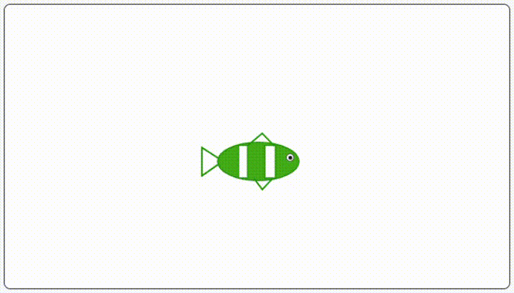
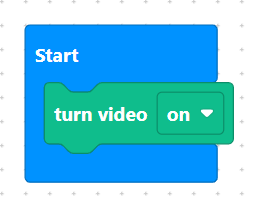
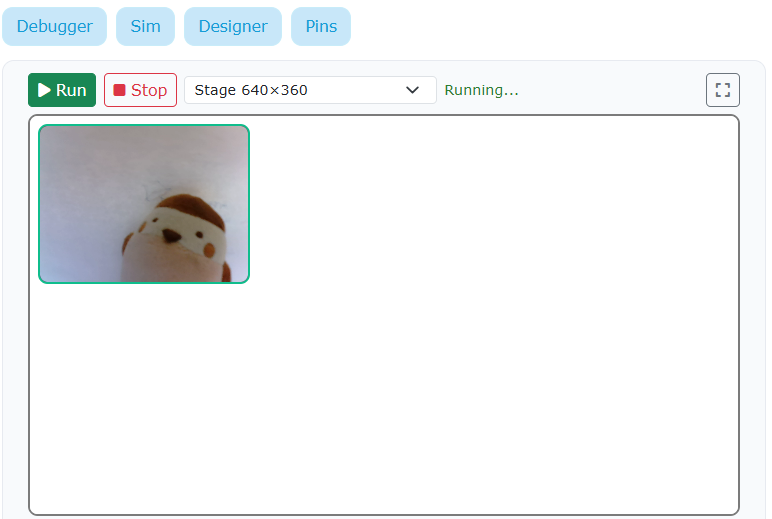
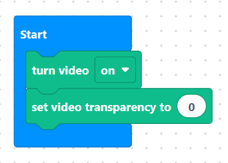
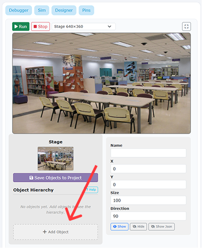
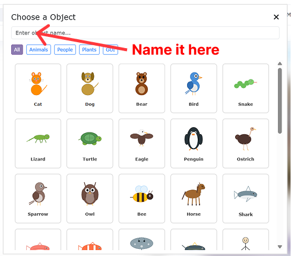

> {width=inherit}

Learn how to use video sensing to detect physical hand movements and change a character's color dynamically using code!

## Project Overview
In this project, you will build an interactive **Magical Fish 2** scene that reacts to real-world movement. Instead of clicking a button, you will use your computer camera to track hand motions and trigger graphic color effects on the fish sprite automatically.

## Learning Objectives
* **Video Sensing:** Initialize and control the camera feed using MicroPython blocks.
* **Motion Detection:** Trigger events based on real-world movement values (`when video motion > 50`).
* **Graphic Effects:** Dynamically shift a sprite's hue using code parameters.

## What You Are Building

You will create an interactive scene where moving your hands in front of the camera changes the fish's color:

* **Camera Feed:** Detects real-world motion on stage.
* **Fish Sprite (`fish`):** Automatically shifts its color effect whenever motion is sensed.

> {width="400"}


## Step 1 - Turn on the Camera
Initialise the camera feed when the project starts. Turn on the video and adjust its transparency so it runs smoothly in the background:

> {width=inherit}

> Note: If your camera successfully turns on, you should see it on the top left corner of the Designer page.

> {width=inherit}

### MicroPython Code
```python
# Turn on the camera and set its transparency when the program starts
await videosensing.turn_video("on")
await videosensing.set_transparency(100) 
```

> {width=inherit}

## Step 2 - Add Objects: The Fish
Open the Object Library and add two sprites to your stage:
1. Add a **Fish** sprite and name it **`fish`**.

> {width=inherit}
> {width=inherit}

## Step 3 - Code the Video Motion Event
Program the project to listen for camera movement. Whenever the detected video motion exceeds 50, change the fish's color effect by 25:

```python
# When video motion is greater than 50, shift the fish's color effect by 25
def when_video_motion_greater_than(50):
    fish.change_effect("color", 25)
```


## ⚠️ Common Mistakes to Avoid
1. Camera Permissions Blocked
The Error: The video feed fails to show up on the top left corner of the Designer page.

  The Fix: Check your browser or system permission settings to ensure the application is allowed to access your webcam.

2. Motion Threshold Too High or Low
The Error: The fish changes color constantly without moving, or won't change color no matter how much you wave.

   The Fix: Adjust the motion number threshold value (e.g., try 30 for more sensitivity or 70 for less sensitivity).

> **Challenge**: Try adding a sound effect (start_sound("pop")) inside the motion event so it plays every time your hand movement triggers a color shift!